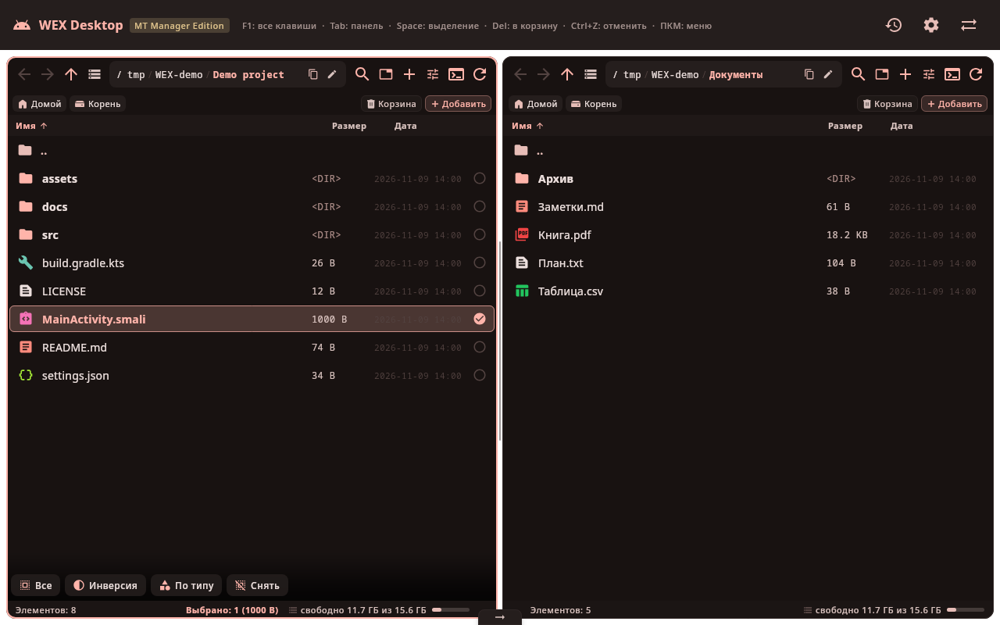
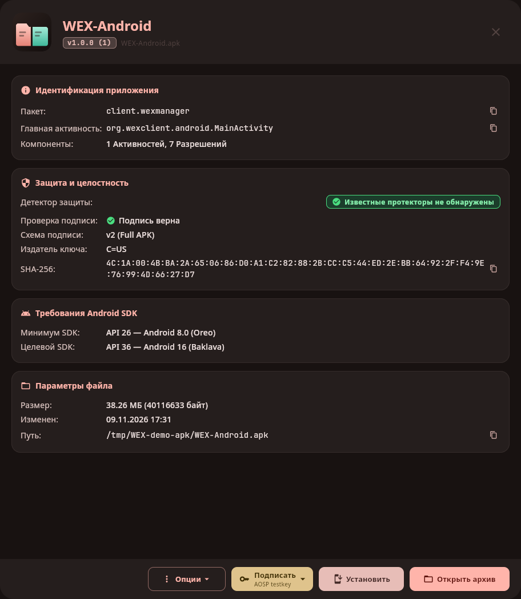
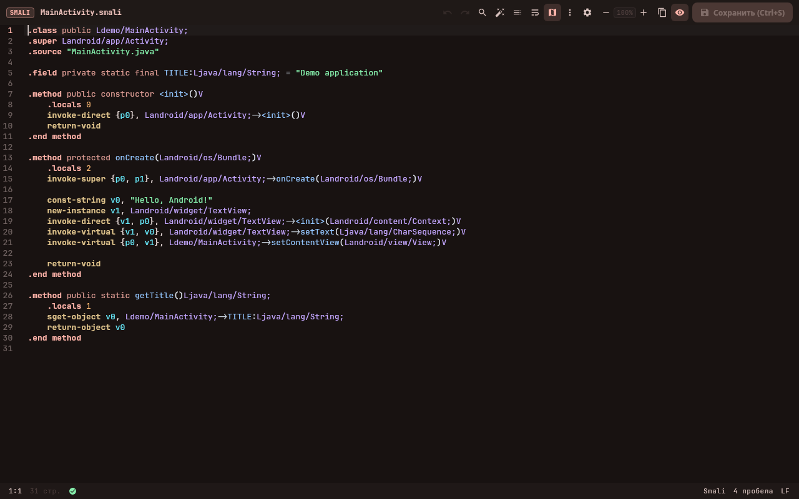
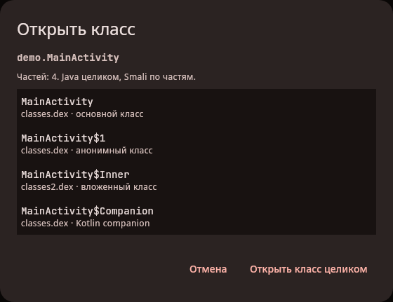
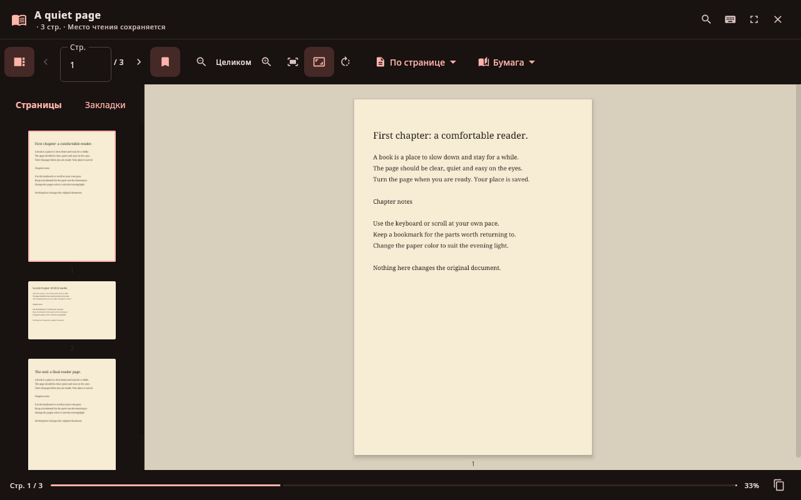

# WEX Desktop

[](https://github.com/inclusivnp-max/wexmanager/actions/workflows/build.yml)
[](https://github.com/inclusivnp-max/wexmanager/releases/latest)

Двухпанельный файловый менеджер для Linux и Windows с инструментами для Android-приложений.
Работает с файлами и архивами, открывает APK, декомпилирует DEX, позволяет править
Smali и ресурсы, подписывать пакеты и устанавливать их на телефон через ADB.
Есть общий редактор кода, hex-редактор и встроенный терминал.

[Скачать готовую сборку](https://github.com/inclusivnp-max/wexmanager/releases/latest) ·
[Что вошло в 1.0.0](docs/releases/v1.0.0.md)



## Основные возможности

- **Файловый менеджер.** Две панели, вкладки и закладки; копирование и перенос,
  корзина и отмена операций, пакетное переименование и контрольные суммы.
  Поиск по имени и содержимому, поиск дубликатов, сравнение папок и анализ занятого места.
- **APK, DEX и Smali.** Информация о пакете, разрешениях и подписях; просмотр
  манифеста, правка ресурсов и Smali, подпись и сравнение версий приложения.
  Java-декомпиляция через jadx, CFR, Vineflower и Procyon; экспорт проекта через jadx.
- **Архивы.** ZIP, TAR и его сжатые варианты открываются как папки.
  Можно работать с вложенными архивами, AppImage и наборами split APK.
  Для 7z и RAR нужны внешние архиваторы.
- **Редакторы.** Подсветка кода, автодополнение, сворачивание блоков, несколько
  кареток, поиск и замена с регулярными выражениями. Есть hex-редактор,
  сравнение текстов и предпросмотр Markdown и HTML.
- **Телефон и сервер.** Файлы по ADB и SSH/SFTP. Для приложений Android —
  выгрузка APK, установка, запуск, остановка, очистка данных и удаление.
  Терминал открывается в папке текущей панели.
- **Просмотр файлов.** Изображения, аудио, видео, PDF-книги, DOCX, XLSX и SQLite.
  Отдельные инструменты открывают ELF, Java-классы, ARSC и бинарный XML Android.

У проекта также есть Android-приложение. Его просмотрщики, запуск команд и
доступ к хранилищу отличаются от настольной версии.

## Скриншоты

**Работа с APK:** сведения о приложении, подпись, манифест, DEX и установка.



<details>
<summary>Smali-редактор, вложенные классы и просмотр PDF</summary>

**Smali-редактор** с подсветкой, навигацией по коду, поиском и сохранением.



**DEX и Java:** можно открыть класс целиком или выбрать отдельную вложенную часть.
Группа включает доступные части из разных DEX одного открытого набора.



**PDF-читалка:** темы страниц, миниатюры, закладки, поиск и сохранение места чтения.



</details>

## Готовые сборки

Откройте [последний выпуск](https://github.com/inclusivnp-max/wexmanager/releases/latest)
и скачайте файл для своей системы. Java для настольных сборок уже внутри.

| Система | Файл выпуска 1.0.0 | Как запустить |
| --- | --- | --- |
| Linux x64 | [WEXdesktop-linux-x64.tar.gz](https://github.com/inclusivnp-max/wexmanager/releases/download/v1.0.0/WEXdesktop-linux-x64.tar.gz) | Распаковать архив, запустить `WEXdesktop/start.sh` |
| Windows x64 | [WEXdesktop-1.0.0.msi](https://github.com/inclusivnp-max/wexmanager/releases/download/v1.0.0/WEXdesktop-1.0.0.msi) | Открыть установщик MSI |
| Android 8.0+ | [WEX-Android-1.0.0-debug.apk](https://github.com/inclusivnp-max/wexmanager/releases/download/v1.0.0/WEX-Android-1.0.0-debug.apk) | Установить APK; нужен Android API 26 или новее |

Рядом со сборками лежит `SHA256SUMS` для проверки скачанных файлов.
Android APK подписан отладочным ключом. В следующих выпусках ключ может отличаться:
тогда перед установкой потребуется удалить предыдущую версию Android-приложения.

Свежие промежуточные сборки доступны в разделе **Artifacts** успешного запуска
[GitHub Actions](https://github.com/inclusivnp-max/wexmanager/actions/workflows/build.yml).

## PDF-книги

Читалка запоминает страницу, прокрутку, тему, масштаб и закладки отдельно для каждой книги.
Есть непрерывная прокрутка, просмотр по странице, текстовый режим с переносом,
поиск по всей книге и полный экран. Исходный PDF не меняется.

Нужен **Poppler** (`pdfinfo`, `pdftoppm`, `pdftotext`) в `PATH`.
Поиск и текстовый режим используют текстовый слой PDF; для сканов нужен OCR.

## Сборка и запуск

Нужны **Git**, **JDK 21**, **Android SDK 37.0** и **Build Tools 37.0.0**.
Gradle отдельно устанавливать не нужно — в репозитории есть wrapper.
Android SDK требуется и для настольной сборки: Android-модули подключены
в общем [settings.gradle.kts](settings.gradle.kts).

```bash
git clone https://github.com/inclusivnp-max/wexmanager.git
cd wexmanager
```

SDK можно установить через Android Studio или командные инструменты Android:

```bash
sdkmanager "platform-tools" "platforms;android-37.0" "build-tools;37.0.0"
```

Путь к SDK задаётся через `ANDROID_HOME` или `sdk.dir` в локальном файле
`local.properties`. Например, в Linux:

```properties
sdk.dir=/home/yourname/Android/Sdk
```

В Windows можно использовать прямые слеши: `sdk.dir=C:/Android/Sdk`.
Этот файл, сборки и личные ключи в Git не попадают. Для первого запуска сборки
нужен интернет: Gradle скачивает зависимости из объявленных репозиториев.

Исходники clazzpatcher уже находятся в [third_party/clazzpatcher/](third_party/clazzpatcher/).
Gradle собирает их вместе с WEX; скачивать библиотеку отдельно или настраивать
путь к ней не нужно. В каталоге сохранены её тесты, тестовые файлы и документация.

Для разработки с отдельной копией библиотеки путь можно переопределить:

```bash
./gradlew -Pclazzpatcher.dir=/path/to/clazzpatcher :app:run
```

Основные команды из корня проекта:

```bash
./gradlew :app:run                    # запустить настольную версию
./gradlew :app:classes                # скомпилировать её без запуска
./gradlew :shared:desktopTest         # выполнить JVM-тесты
./gradlew :androidApp:assembleDebug   # собрать отладочный APK
```

В PowerShell вместо `./gradlew` используется `.\gradlew.bat`.

В Linux для тестов интерфейса нужен графический сеанс или Xvfb:

```bash
xvfb-run -a ./gradlew :shared:desktopTest
```

Проверки скриптов запуска выполняются после сборки `:app:installDist`:

```bash
python3 tools/test_packaging.py
```

В Windows эта команда запускается через `python`.

### Дистрибутив

```bash
./gradlew :app:installDist   # приложение и скрипты запуска, без Java
./gradlew :app:packageApp    # пакет со встроенной Java
```

`installDist` создаёт каталог `app/build/install/app/`, скрипты лежат в `bin/`.
`packageApp` на Linux собирает `app/build/packages/WEXdesktop-linux-x64.tar.gz`,
на Windows — MSI в `app/build/packages/`. Пакет собирается на целевой ОС.
Linux-версия из архива запускается через `WEXdesktop/start.sh`.
Для MSI нужен WiX Toolset 3 (`candle.exe` и `light.exe` в `PATH`).

В собранном приложении `--help` показывает параметры запуска, а `--version` —
версию. Эти команды работают без графического сеанса. `--background` запускает
WEX без открытия окна; путь к файлу или папке можно передать отдельным аргументом.

## Внешние инструменты

WEX ищет эти программы в `PATH`. Они нужны для соответствующих функций,
а не для всех операций с файлами.

| Программа | Функция |
| --- | --- |
| `fd`, `rg` (ripgrep) | Ускоренный поиск по именам и содержимому |
| `git` | Отметки состояния файлов |
| `ssh`, `sftp` | Работа с сервером |
| `adb` | Работа с Android-устройством |
| `7z`, `unrar` | Архивы 7z и RAR |
| `ffmpeg`, `ffprobe`, `ffplay` | Аудио, видео, метаданные и миниатюры |
| Poppler: `pdfinfo`, `pdftoppm`, `pdftotext`, `pdfunite` | Просмотр и обработка PDF |
| Chromium или Google Chrome | Предпросмотр HTML |
| `objdump`, `llvm-objdump` | Дизассемблирование ELF; для ARM/AArch64 нужен `llvm-objdump` |

## Клавиши

Основные сочетания настольной версии:

| Клавиши | Действие |
| --- | --- |
| `Tab` | Другая панель |
| `F2` | Переименовать |
| `F3` / `F4` | Просмотр / редактирование |
| `F5` / `F6` | Копировать / перенести в другую панель |
| `F7` | Создать папку |
| `Delete` / `Shift+Delete` | В корзину / удалить навсегда |
| `Ctrl+Z` | Отменить файловую операцию |
| `Ctrl+F` / `Ctrl+Shift+F` | Поиск по имени / содержимому |
| `Ctrl+D` | Сравнить с файлом в соседней панели |
| `Ctrl+Shift+H` | Hex-редактор |
| `Ctrl+T` | Терминал панели |
| `Ctrl+Shift+K` / `Ctrl+Shift+M` | SSH / телефон через ADB |

Полный список открывается по `F1`. Сочетания меняются в настройках, в разделе «Бинды».

## Каталоги проекта

- [`app/`](app/) — запуск настольной версии и сборка дистрибутивов.
- [`shared/src/commonMain/`](shared/src/commonMain/) — файловая система, редакторы,
  APK-инструменты и общий интерфейс.
- [`shared/src/desktopMain/`](shared/src/desktopMain/) и
  [`shared/src/androidMain/`](shared/src/androidMain/) — платформенные реализации.
- [`shared/src/desktopTest/`](shared/src/desktopTest/) — JVM-тесты и тестовые файлы.
- [`androidApp/`](androidApp/) — Android-приложение, разрешения и навигация.
- [`buildSrc/`](buildSrc/) — общая логика Gradle.
- [`third_party/clazzpatcher/`](third_party/clazzpatcher/) — исходники библиотеки DEX/smali.
- [`gradle/libs.versions.toml`](gradle/libs.versions.toml) — версии зависимостей.

Настройки настольной версии лежат в `~/.config/wexdesktop/`, кэш —
в `~/.cache/wexdesktop/`. Ключи подписи хранятся в подкаталоге `keys/`,
сочетания клавиш — в `keymap.properties`.

HTML-предпросмотр и внешние изображения Markdown могут обращаться к сети.
Загрузка изображений Markdown меняется в настройках редактора.
